# FlowForge Analytics

FlowForge Analytics is a web application that turns a CSV export of business data into checked, cleaned and explained results. It imports the file, validates it, finds quality problems and helps fix them, calculates business metrics, draws charts, writes plain-language insights, produces downloadable reports and can pass the results to a Make.com scenario.


## Contents

1. [Product overview](#1-product-overview)
2. [The problem it addresses](#2-the-problem-it-addresses)
3. [Main features](#3-main-features)
4. [Technology stack](#4-technology-stack)
5. [Architecture overview](#5-architecture-overview)
6. [Repository structure](#6-repository-structure)
7. [Prerequisites](#7-prerequisites)
8. [Installation](#8-installation)
9. [Starting the backend](#9-starting-the-backend)
10. [Starting the frontend](#10-starting-the-frontend)
11. [Environment variables](#11-environment-variables)
12. [Sample dataset](#12-sample-dataset)
13. [Uploading and analysing a dataset](#13-uploading-and-analysing-a-dataset)
14. [Generating reports](#14-generating-reports)
15. [AI integration](#15-ai-integration)
16. [Make.com integration](#16-makecom-integration)
17. [API documentation](#17-api-documentation)
18. [Testing](#18-testing)
19. [Production build](#19-production-build)
20. [Security considerations](#20-security-considerations)
21. [Storage behaviour](#21-storage-behaviour)
22. [Known limitations](#22-known-limitations)
23. [Troubleshooting](#23-troubleshooting)
24. [Future improvements](#24-future-improvements)

## 1. Product overview

The application follows one workflow, mirrored in its navigation:

**Import → Validate → Improve quality → Analyse → Visualise → Insights → Report → Automate**

| Section | What it does |
| --- | --- |
| Dashboard | Key metrics, revenue trend, top categories, recent reports and activity for the selected dataset |
| Data Upload | Drag-and-drop CSV upload with progress, server-side validation, column types and a preview |
| Datasets | All stored datasets with size and quality; select, rename, download or delete |
| Data Quality | Quality score, findings with their effect on analysis, and cleaning operations with preview, apply and reset |
| Data Analysis | Column mapping, business metrics, period comparison, trend, breakdowns, column statistics, correlations |
| Visualisations | Default trend and category charts plus a chart builder (by group, over time, distribution), each with a table view and CSV download |
| AI Insights | Rule-based insights, optionally extended by an AI provider, each labelled as fact, interpretation or suggestion |
| Reports | Generate a report as HTML, PDF, CSV and JSON, and optionally send it to Make.com |
| Report History | Every generated report with downloads and deletion |
| Automation | Make.com status, payload preview, manual sending and delivery history |
| Settings | Integration status, storage, upload limits, display currency and API documentation link |

## 2. The problem it addresses

Small teams often receive sales or operations data as spreadsheets exported from different systems. Before anyone can trust a total, someone has to spot duplicated rows, unreadable dates, misspelt categories and missing values, then calculate the same metrics again and write them up. FlowForge makes that routine repeatable: it shows exactly what is wrong with a file and how it affects the numbers, keeps the original data intact while fixing it, and produces a report whose every figure comes from the data rather than from guesswork.

## 3. Main features

**Import and validation**
- CSV upload up to a configurable size, row and column limit
- UTF-8 (with or without BOM) and Windows-1252 decoding; comma, semicolon, tab and pipe delimiters detected automatically
- Rejects empty, binary and malformed files and rows with the wrong number of fields, with a readable reason
- Blank and duplicate header names are repaired and reported
- Column types inferred from the values: numeric, date, boolean, categorical, text, identifier
- Business columns (date, revenue, quantity, unit price, category, product, region, status) detected from their names and adjustable by the user

**Data quality**
- Checks for missing values, duplicate rows, duplicate identifiers, invalid numbers, unreadable dates, inconsistent category spelling, negative values, revenue that does not equal quantity × unit price, extreme values, future dates and constant columns
- A documented score: `100 × (1 − weighted affected cells ÷ total cells)`, errors weighted 1.0, warnings 0.5, information 0
- Each finding explains its effect on analysis and offers a suggested fix

**Cleaning**
- Remove duplicates, fill missing values (constant, mean, median or most common), drop rows with missing values, convert to numbers, convert to dates (stored as ISO dates), normalise text, remove invalid rows, drop a column
- Every operation can be previewed before it is applied; operations that remove rows or columns ask for confirmation
- The original upload is always kept; the cleaning history can be reset in one step

**Analysis and charts**
- Records, total revenue, average and median transaction value, total quantity, distinct categories, products and regions, date range
- Revenue is taken from a revenue column or, if there is none, calculated as quantity × unit price (and labelled as such)
- Time series with automatic granularity, partial periods marked; latest complete period compared with the previous one; fitted trend
- Breakdowns by category, product, region and status with shares
- Column statistics, distributions and correlations (with a reminder that correlation is not causation)
- Every chart has a table view; grouped results can be downloaded as CSV

**Insights, reports and automation**
- Rule-based insights generated from the analysis, always available
- Optional AI insights from aggregated figures only, with automatic fallback
- Reports in HTML (self-contained, with charts), PDF, CSV and JSON, stored with history
- Optional Make.com webhook with HMAC signing, payload preview, manual or rule-based sending, and delivery history

## 4. Technology stack

| Layer | Technology |
| --- | --- |
| Frontend | React 19, TypeScript, Vite 8, Tailwind CSS 4, Recharts 3, React Router 7, lucide-react |
| Frontend quality | ESLint with typescript-eslint, Vitest with Testing Library |
| Backend | Python 3.11+, FastAPI, Pydantic 2, pandas, NumPy, ReportLab (PDF), httpx (webhooks), an AI provider SDK (optional) |
| Backend quality | pytest, Ruff |
| Storage | SQLite and files on local disk |
| CI | GitHub Actions |

## 5. Architecture overview

The React application talks only to the FastAPI backend under `/api`. In development, Vite proxies `/api` to the backend; in production the backend can serve the built frontend itself, so the browser always uses a single origin.

The backend is layered: routes handle HTTP and validation, services implement use cases, the engine holds pure pandas logic (loading, profiling, quality, cleaning, analytics, insights), reporting renders documents, storage wraps SQLite and the file system, and integrations hold the AI provider and webhook client. External services are only called from the backend.

See [docs/architecture.md](docs/architecture.md) for the module map, data layout and frontend structure.

## 6. Repository structure

```
flowforge-analytics/
├── backend/
│   ├── app/
│   │   ├── api/            routes and dependencies
│   │   ├── engine/         loading, profiling, quality, cleaning, analytics, insights
│   │   ├── integrations/   AI provider, Make.com webhook client
│   │   ├── reporting/      HTML, PDF and CSV renderers
│   │   ├── schemas/        Pydantic response models
│   │   ├── services/       use cases
│   │   ├── storage/        SQLite repositories and file stores
│   │   ├── config.py       settings from environment variables
│   │   ├── errors.py       error types and handlers
│   │   └── main.py         application factory
│   ├── tests/              pytest suite
│   ├── pyproject.toml      pytest and Ruff configuration
│   ├── requirements.txt
│   └── requirements-dev.txt
├── frontend/
│   ├── src/                api client, components, pages, hooks, context
│   ├── public/
│   ├── package.json
│   └── vite.config.ts, tsconfig*.json, eslint.config.js
├── sample-data/            synthetic demonstration dataset
├── scripts/                sample data generator, browser walkthrough
├── screenshots/            screenshots of the running application
├── docs/                   architecture and integration guides
├── .github/workflows/      CI
├── .env.example
└── README.md
```

## 7. Prerequisites

- Python 3.11 or newer (CI uses 3.13)
- Node.js 20.19+ or 22.12+ with npm (CI uses Node 22)
- Git

No database server is needed.

## 8. Installation

```bash
git clone https://github.com/Bucicovscaia-AI/flowforge-analytics.git
cd flowforge-analytics

# Backend
cd backend
python -m venv .venv
source .venv/bin/activate          # Windows: .venv\Scripts\activate
pip install -r requirements-dev.txt   # or requirements.txt without test tools
cp ../.env.example .env            # optional; every setting has a default
cd ..

# Frontend
cd frontend
npm install
cd ..
```

## 9. Starting the backend

```bash
cd backend
source .venv/bin/activate
uvicorn app.main:create_app --factory --reload --port 8000
```

The API is then available at `http://127.0.0.1:8000/api` and interactive documentation at `http://127.0.0.1:8000/api/docs`. Check it with:

```bash
curl http://127.0.0.1:8000/api/health
```

## 10. Starting the frontend

In a second terminal:

```bash
cd frontend
npm run dev
```

Open `http://localhost:5173`. Requests to `/api` are proxied to `http://127.0.0.1:8000`; set `FLOWFORGE_API_URL` before `npm run dev` if the backend runs elsewhere. The top bar shows **API connected** when the frontend can reach the backend.

## 11. Environment variables

All variables are read by the backend. Copy [.env.example](.env.example) to `backend/.env` (or `.env` in the repository root). Real environment variables take precedence over the file.

| Variable | Default | Purpose |
| --- | --- | --- |
| `DATA_DIR` | `backend/data` | Where the database, datasets and reports are stored (relative paths resolve from `backend/`) |
| `SAMPLE_DATA_PATH` | `sample-data/flowforge-retail-sample.csv` | Sample dataset loaded by **Load sample dataset** |
| `MAX_UPLOAD_MB` | `10` | Maximum upload size |
| `MAX_ROWS` | `500000` | Maximum data rows per file |
| `MAX_COLUMNS` | `200` | Maximum columns per file |
| `CORS_ORIGINS` | `http://localhost:5173,http://127.0.0.1:5173` | Browser origins allowed to call the API directly |
| `FRONTEND_DIST_DIR` | empty | Path to `frontend/dist` to serve the built frontend from the backend |
| `PUBLIC_BASE_URL` | empty | Public address of the server, used for report links in webhook payloads |
| `LOG_LEVEL` | `INFO` | Python log level |
| `AI_PROVIDER` | `anthropic` when a key is set | AI provider; `none` disables AI |
| `AI_API_KEY` | empty | Provider API key; AI insights are off without it |
| `AI_MODEL` | `claude-opus-5-5` | Model id |
| `AI_TIMEOUT_SECONDS` | `45` | Provider request timeout |
| `AI_MAX_OUTPUT_TOKENS` | `4000` | Maximum response length |
| `MAKE_WEBHOOK_URL` | empty | Make.com custom webhook address (HTTPS) |
| `MAKE_WEBHOOK_SECRET` | empty | Optional HMAC signing secret |
| `MAKE_TIMEOUT_SECONDS` | `10` | Webhook request timeout |
| `AUTOMATION_TRIGGER_ON_REPORT` | `false` | Send every newly generated report to Make.com |

The frontend has one optional build-time variable, `VITE_API_BASE_URL` (default `/api`), for hosting the API on a different address. Never put secrets in `VITE_` variables: they are compiled into the browser bundle.

## 12. Sample dataset

[`sample-data/flowforge-retail-sample.csv`](sample-data/flowforge-retail-sample.csv) contains 1,198 fabricated retail orders for 2025 with order id, date, product, category, quantity, unit price, revenue, region, channel and status. **It is synthetic demonstration data and does not describe any real business.** It deliberately contains a few problems to fix: duplicated rows, unreadable dates, missing regions and channels, and inconsistent region spelling.

Load it from the Dashboard (**Explore sample data**) or Data Upload (**Load sample dataset**). It is labelled **Demonstration data** throughout the interface and in report payloads (`is_sample: true`).

The file is reproducible:

```bash
python scripts/generate_sample_data.py
```

## 13. Uploading and analysing a dataset

1. **Data Upload:** drop a CSV file on the upload area or choose one, optionally name it, and press **Upload and validate**. The file is checked in the browser (type, size) and again on the server. You then see row and column counts, the quality score, any adjustments made while reading, the inferred column types and a preview.
2. **Data Quality:** review findings, ordered by severity. Press a finding's suggested fix (for example **Remove duplicate rows**), check the preview of what would change, then **Apply to working copy**. Use **Reset to original** to undo all cleaning.
3. **Data Analysis:** check the column mapping (for example which column is revenue) and change it if needed, then read the metrics, period comparison, breakdowns and column statistics.
4. **Visualisations:** use the default charts or build one by group, over time or as a distribution. Switch to **Table** for exact values, or download grouped results as CSV.
5. **AI Insights:** read the rule-based insights. If an AI provider is configured, switch on **Use the AI provider** and press **Generate with AI**.

Choose which dataset you are working on from the selector in the top bar.


## 14. Generating reports

On **Reports**, optionally give the report a title, choose whether to include AI insights (when configured) and press **Generate report**. The report contains the dataset summary and quality score, key metrics, the trend chart and period comparison, top groups, insights labelled by source, quality findings and cleaning steps applied, and limitations.

Download it as:

- **HTML:** a self-contained page with inline charts (open it with **Open**)
- **PDF:** a printable document
- **CSV:** metrics, breakdowns and periods as tables
- **JSON:** the full report content for other systems

All reports appear in **Report History**, where they can be downloaded again or deleted.

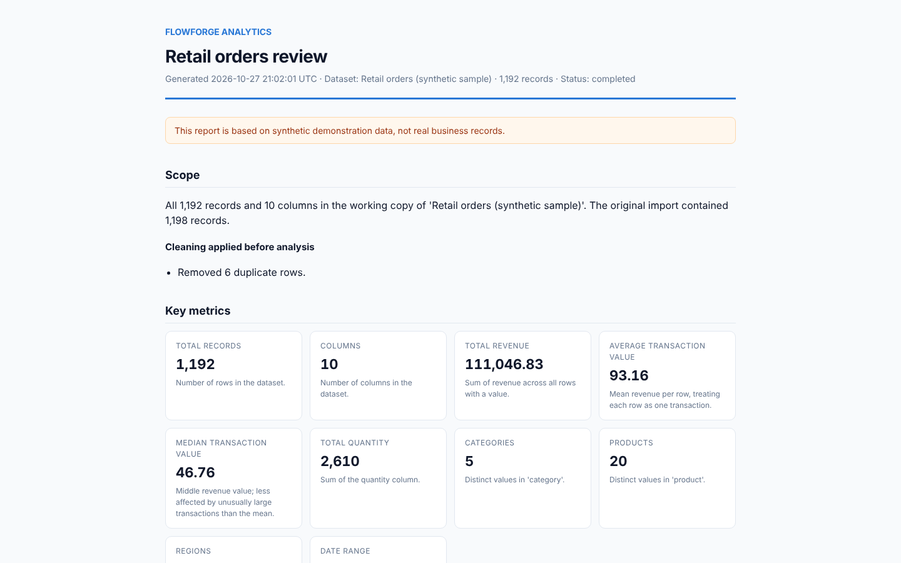

## 15. AI integration

AI insights are optional. Set `AI_API_KEY` (and optionally `AI_MODEL`) in the backend environment and restart. The provider is only called when a user asks for AI insights, receives aggregated figures only (never raw rows), and must return structured JSON. If it fails or is not configured, FlowForge shows its rule-based insights and says why. AI insights are always labelled as AI-generated.

Full details, including exactly what is sent: [docs/integrations.md](docs/integrations.md#ai-insights).

## 16. Make.com integration

1. Create a Make.com scenario starting with **Webhooks › Custom webhook** and copy its address.
2. Set `MAKE_WEBHOOK_URL` (and optionally `MAKE_WEBHOOK_SECRET`) in the backend environment and restart.
3. On **Automation**, send an `automation.test` event so Make.com can learn the data structure, then build the rest of the scenario.

Events are sent only when a user presses **Send to Make.com**, or automatically for new reports if `AUTOMATION_TRIGGER_ON_REPORT=true`. The webhook address is never sent to the browser. Payload format, signature verification and failure behaviour: [docs/integrations.md](docs/integrations.md#makecom-automation).

## 17. API documentation

With the backend running, interactive OpenAPI documentation is at `/api/docs` and the schema at `/api/openapi.json`. Main endpoints:

| Method and path | Purpose |
| --- | --- |
| `GET /api/health` | Health check |
| `GET /api/system/status` | Integration status and limits (no secrets) |
| `POST /api/datasets/upload` | Upload a CSV (multipart field `file`, optional `name`) |
| `POST /api/datasets/sample` | Import the sample dataset |
| `GET /api/datasets`, `GET/PATCH/DELETE /api/datasets/{id}` | List, read, rename, delete |
| `PUT /api/datasets/{id}/column-mapping` | Override detected business columns |
| `GET /api/datasets/{id}/preview`, `GET /api/datasets/{id}/export.csv` | Preview rows, download the working copy |
| `GET /api/datasets/{id}/quality` | Quality report |
| `GET /api/cleaning/operations` | Available cleaning operations |
| `POST /api/datasets/{id}/cleaning/preview` / `apply` / `reset` | Cleaning |
| `GET /api/datasets/{id}/analysis` | Full analysis |
| `GET /api/datasets/{id}/charts/aggregate`, `timeseries`, `distribution`, `aggregate.csv` | Chart data |
| `POST /api/datasets/{id}/insights` | Insights (`{"use_ai": false}` for rule-based only) |
| `POST /api/reports`, `GET /api/reports`, `GET/DELETE /api/reports/{id}` | Reports and history |
| `GET /api/reports/{id}/download?format=html\|pdf\|csv\|json` | Download a report |
| `GET /api/automation/status`, `POST /api/automation/preview`, `POST /api/automation/trigger`, `GET /api/automation/runs` | Make.com |

Errors always have the form `{"error": {"code": "...", "message": "...", "details": {}}}`.

## 18. Testing

```bash
# Backend: tests and lint
cd backend
source .venv/bin/activate
pytest
ruff check .
ruff format --check .

# Frontend: lint, type checking, unit tests
cd frontend
npm run lint
npm run typecheck
npm test
```

The backend tests cover CSV parsing and validation, type inference, every quality rule, cleaning operations, analytics calculations checked against hand-calculated values, insights, AI fallback and data minimisation (with a fake provider), report generation in every format, webhook delivery and failure handling (with a mocked transport), secrets never appearing in responses, and the API end to end. AI and Make.com tests never contact external services.

The frontend tests cover formatting, file validation, the API client and error handling, interactive components and routing.

[`scripts/e2e_walkthrough.cjs`](scripts/e2e_walkthrough.cjs) drives the built application in Chromium through the whole workflow (upload, rejection of a binary file, sample loading, deletion, cleaning, analysis, charts, CSV export, insights, report generation and every download, automation preview, mobile layout) and saves the screenshots in `screenshots/`. It needs Playwright with Chromium, a fresh backend on port 8000 and `npm run preview` in `frontend/`.

GitHub Actions runs the backend and frontend checks plus the production build on every push to `main` and every pull request.

## 19. Production build

```bash
cd frontend
npm ci
npm run build                 # type checks, then writes frontend/dist

cd ../backend
FRONTEND_DIST_DIR=../frontend/dist uvicorn app.main:create_app --factory --host 0.0.0.0 --port 8000
```

The backend then serves the application at `/` and the API at `/api` from one process and one origin. Put it behind an HTTPS reverse proxy, set `PUBLIC_BASE_URL` if you use webhook links, keep `DATA_DIR` on persistent storage and back it up. `npm run preview` serves the build locally with the same API proxy as development.

## 20. Security considerations

- **Secrets stay on the server.** AI keys, webhook URLs and signing secrets are read from the backend environment, excluded from logs and settings output, and never returned by the API (covered by a test). `.env` files are ignored by Git.
- **Uploads are treated as untrusted data.** Files are size-limited while streaming, checked for type, binary content, encoding and structure, and parsed only as text. Nothing in a file is executed.
- **Filenames are not trusted.** Stored files use server-generated ids; the uploaded name is cleaned and used only as a label. Ids in URLs are validated before use.
- **Spreadsheet formula injection** is neutralised in every CSV export by prefixing cells that start with `=`, `+`, `-`, `@`, tab or carriage return.
- **Reports are static.** HTML reports escape all data and are served with a Content Security Policy that blocks scripts and external requests.
- **External calls need intent.** AI and webhook calls happen only on an explicit user action or the explicitly enabled report rule, with timeouts and error handling. Webhooks must use HTTPS and redirects are not followed.
- **Data minimisation.** Only aggregated figures go to the AI provider; webhook payloads contain metrics, not rows.
- **CORS** is restricted to configured origins, and responses carry `X-Content-Type-Options`, `X-Frame-Options` and `Referrer-Policy` headers.
- **No authentication is built in.** Anyone who can reach the server can use it. Run it on a trusted network or behind an authenticating proxy.

## 21. Storage behaviour

Everything is stored under `DATA_DIR` and survives restarts:

- the original file as uploaded and a working copy that cleaning changes
- dataset metadata, column mapping and cleaning history in SQLite
- generated report files and their metadata
- automation delivery history and an activity log

Deleting a dataset removes its files and cleaning history; reports generated from it are kept, because each report stores its own rendered files. Deleting a report removes its files. The display currency setting is stored in the browser only. To start from scratch, stop the backend and delete the `DATA_DIR` folder.

## 22. Known limitations

- CSV only; Excel files must be exported to CSV first. Files are processed in memory, so the size limit should stay modest.
- Single-user, single-server design with no authentication or per-user data separation.
- Business columns are detected from English column names; other names need manual mapping.
- Dates in ambiguous formats are interpreted day-first (for example `03/04/2025` is 3 April) and the chosen format is shown.
- Revenue is treated as a single currency; the currency symbol is only a display label.
- Trends are straight-line fits over past periods and are not forecasts.
- Only one AI provider is implemented (see `AI_PROVIDER`), and AI output is labelled but not automatically fact-checked.
- The Make.com integration has been tested against a mocked HTTP transport, not a live scenario.
- No scheduled reports: reports are generated on request.

## 23. Troubleshooting

| Symptom | Likely cause and fix |
| --- | --- |
| Top bar shows **API unreachable** | The backend is not running on port 8000, or `FLOWFORGE_API_URL` points elsewhere. Start it with the command in section 9. |
| `Error loading ASGI app` | Run uvicorn from the `backend` folder with `app.main:create_app --factory`; there is no module-level `app` object. |
| Upload rejected as too large | Raise `MAX_UPLOAD_MB` (and `MAX_ROWS` if needed) and restart the backend. |
| "The file appears to be binary" | The file is not plain text, for example an `.xlsx` renamed to `.csv`. Export it as CSV. |
| "The file could not be parsed as CSV" or "The header has N columns but the data has M" | A row has extra delimiters or unbalanced quotes, often an unquoted comma inside a value. Fix the row or re-export with quoting. |
| Revenue or dates missing from the analysis | Check the column mapping on Data Analysis, and convert text columns with the cleaning operations. |
| AI toggle is disabled | `AI_API_KEY` is not set or the backend was not restarted. Settings shows the current status. |
| AI insights fall back to rule-based | The notice above the insights gives the reason (key rejected, model not found, rate limit, timeout). |
| **Send to Make.com** is disabled | `MAKE_WEBHOOK_URL` is missing or not HTTPS. The Automation page shows the problem. |
| PDF shows `?` for some characters | The built-in PDF fonts cover Western European characters only; use the HTML report for other scripts. |

## 24. Future improvements

- User accounts, authentication and per-user datasets
- Excel and Parquet import, and streaming processing for larger files
- Scheduled reports and more automation events
- Additional AI providers and numeric validation of AI statements against the summary
- Saved chart configurations and dashboards per dataset
- Multi-currency handling and configurable fiscal periods
- Container image and deployment templates

## Screenshots

All screenshots were captured from the running application with the synthetic sample dataset.

| | |
| --- | --- |
| 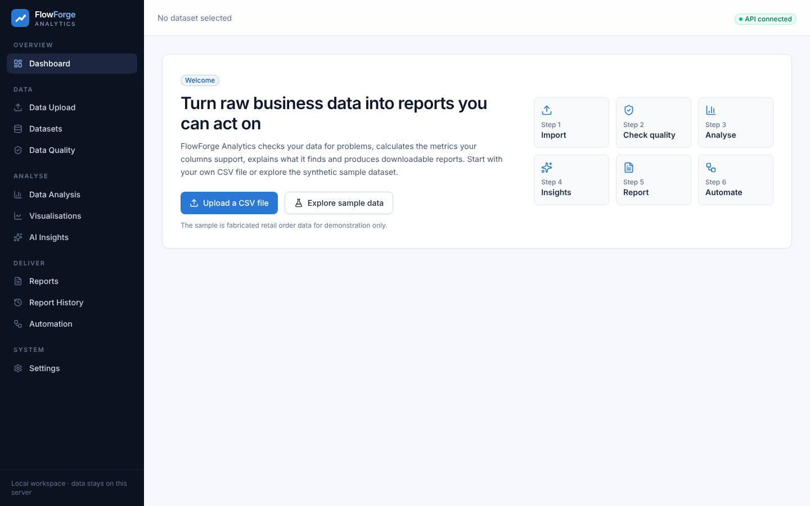 Onboarding | 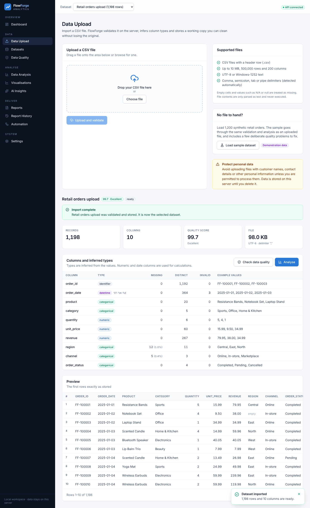 Upload result |
| 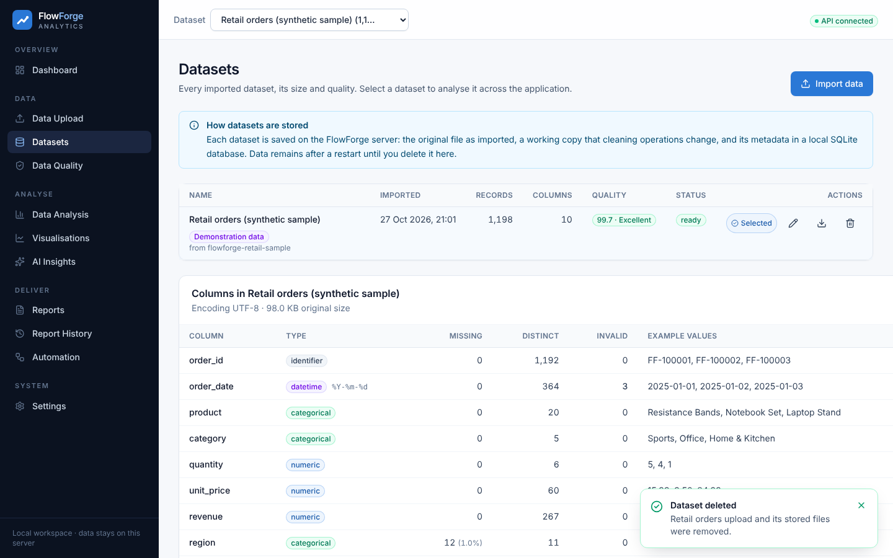 Datasets | 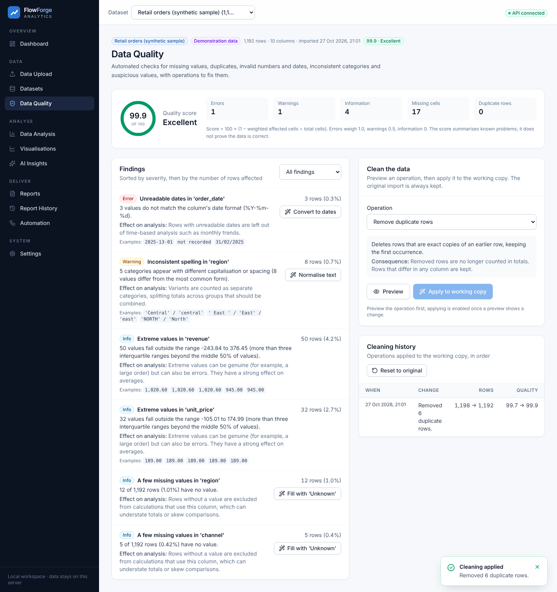 Quality after cleaning |
| 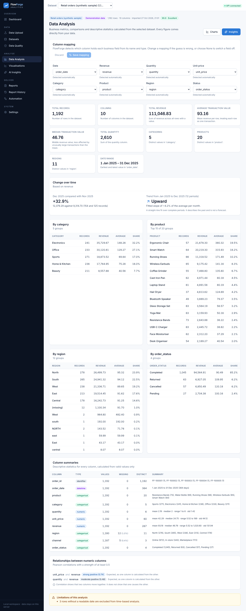 Data Analysis | 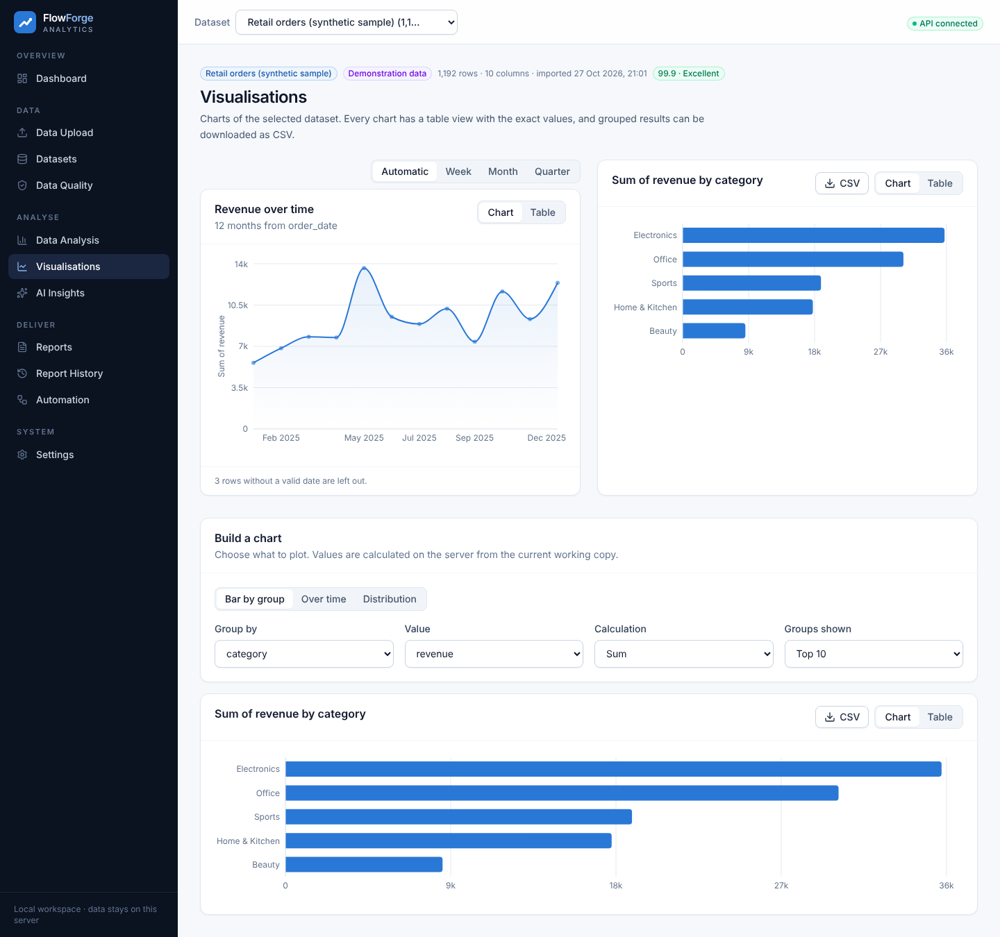 Visualisations |
| 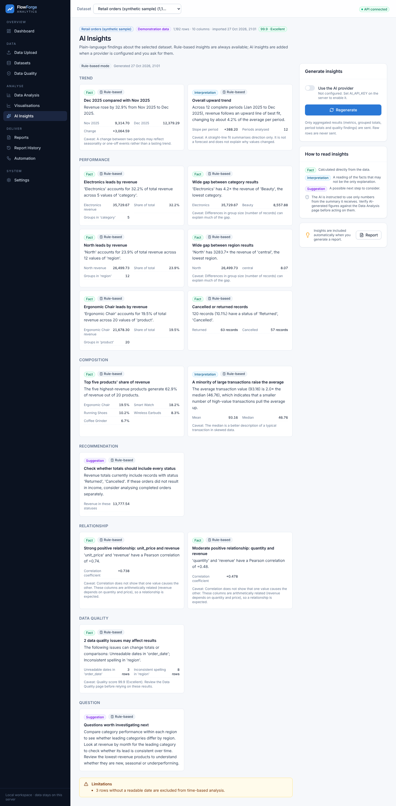 AI Insights (rule-based mode) | 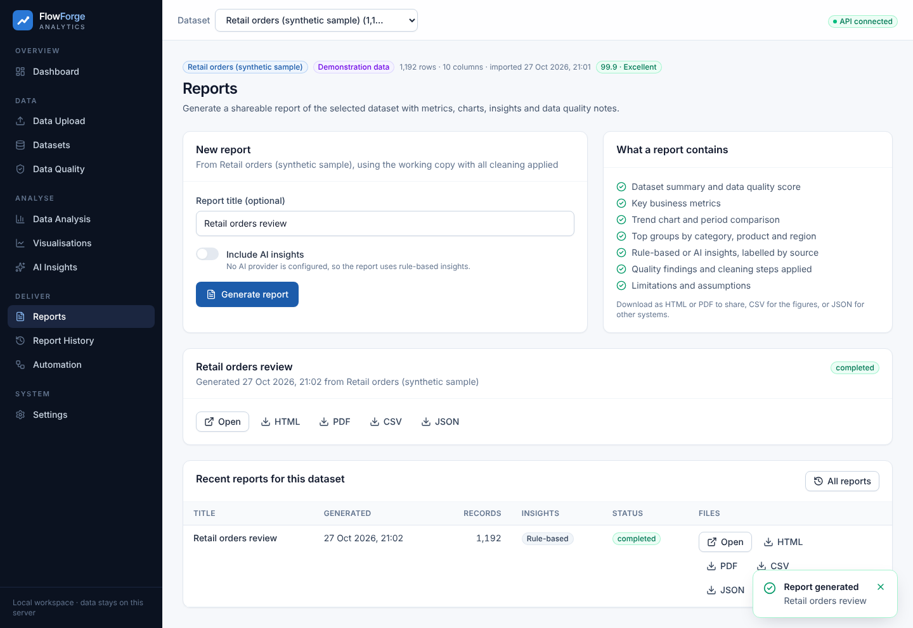 Reports |
| 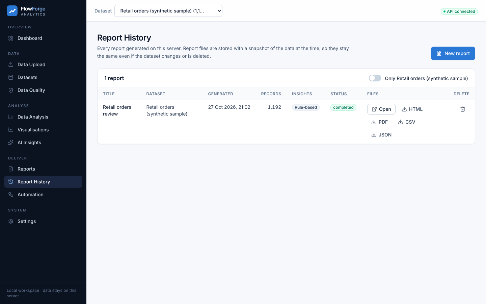 Report History | 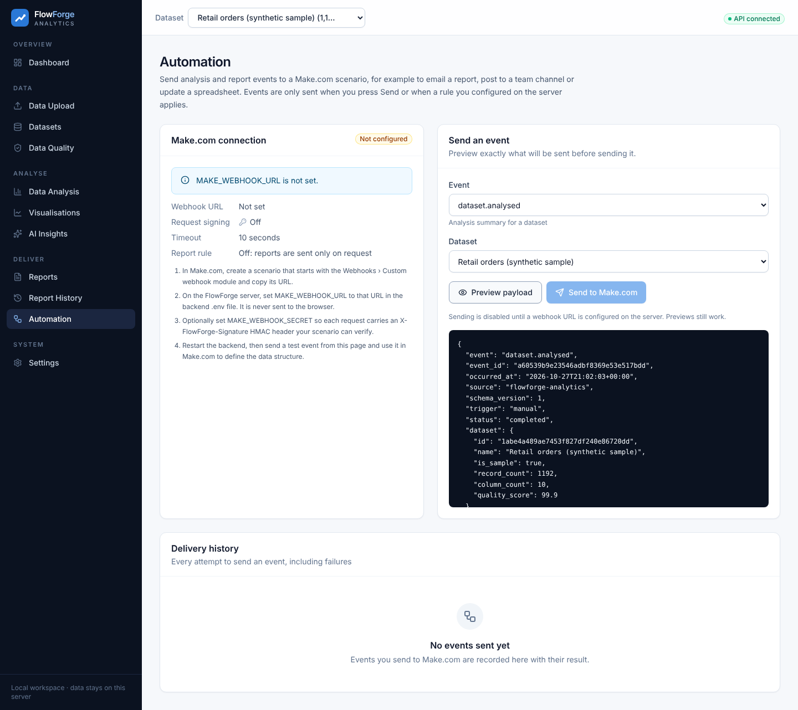 Automation (not configured) |
| 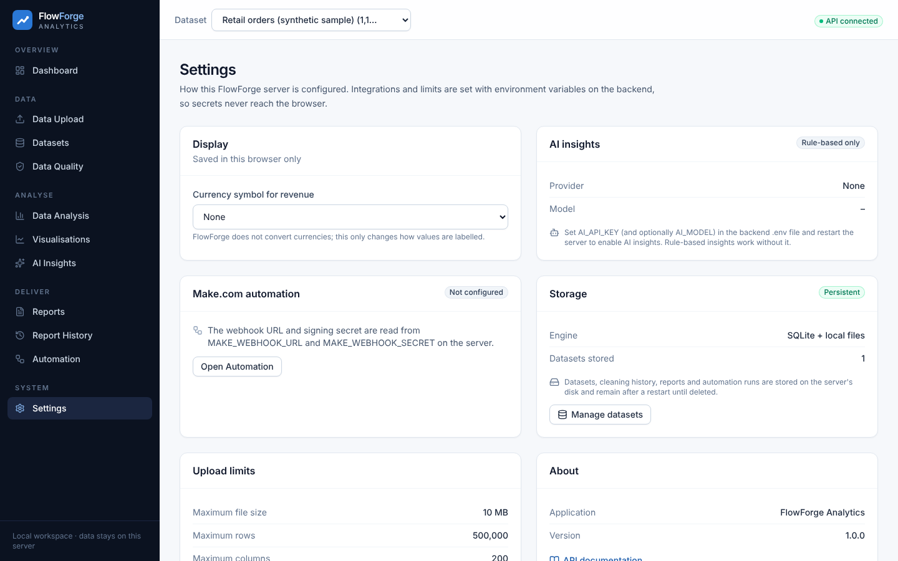 Settings | 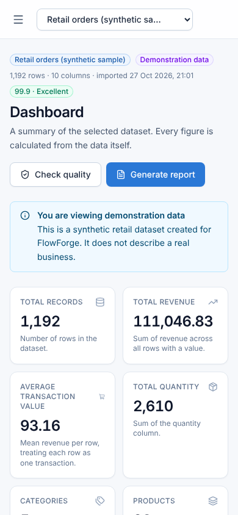 Mobile dashboard |
