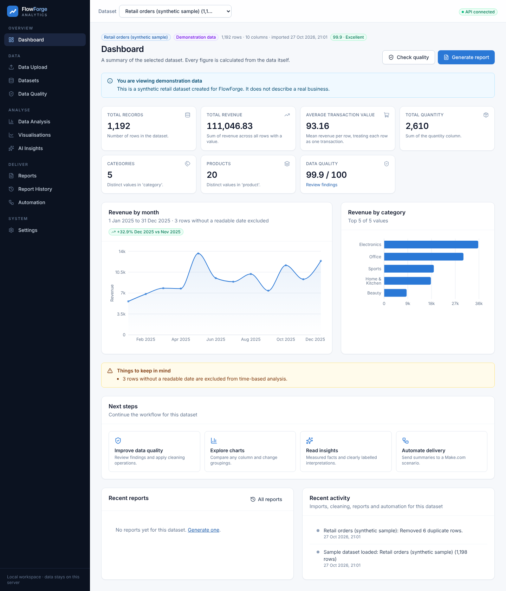
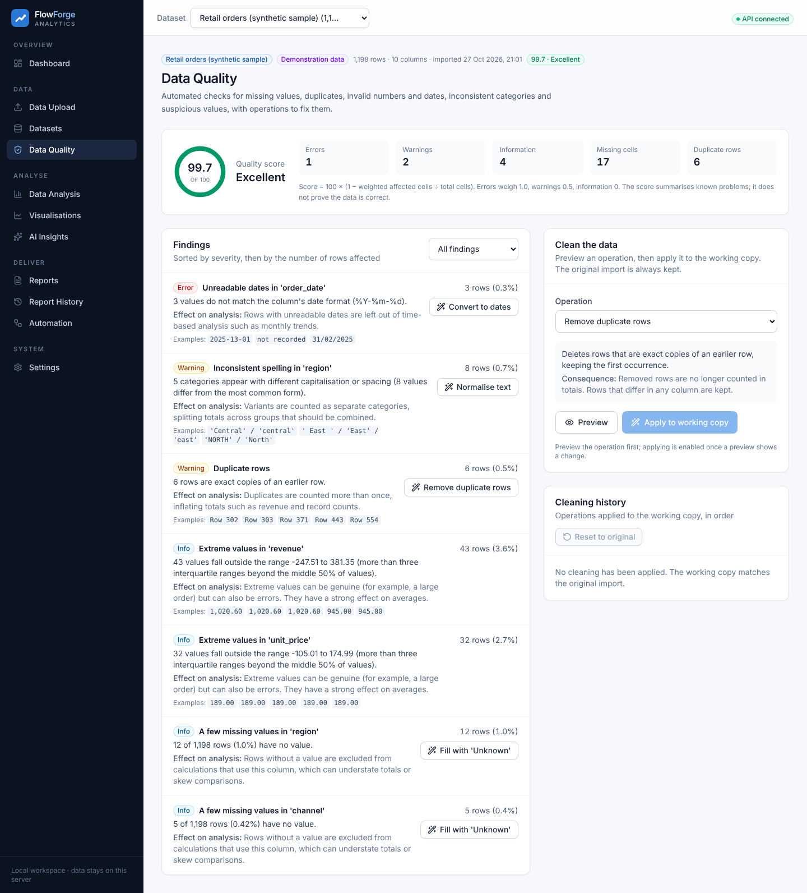

# FlowForge Analytics

FlowForge Analytics is a web application for importing CSV business data, checking and cleaning it, analysing it and producing reports. It has a React frontend and a FastAPI backend.

## Purpose

Data exported from sales or operations systems often contains duplicated rows, unreadable dates, inconsistent categories and missing values. FlowForge shows which problems a file has and how they affect the results, applies fixes to a working copy while keeping the original upload, and calculates metrics, charts and reports from the cleaned data. Reports can be sent to a Make.com scenario, for example to email the PDF.

Live instance: <https://flowforge-analytics.onrender.com> (Render free plan: it may take up to a minute to start, and uploaded data is cleared on restart; a synthetic sample dataset is loaded automatically).



## Features

- CSV import with encoding and delimiter detection, validation and column type inference
- Data quality checks with a documented quality score
- Cleaning operations with preview, applied to a working copy and resettable
- Business metrics, period comparison, breakdowns, column statistics and correlations
- Charts with table views and CSV export
- Rule-based insights, with optional insights from an AI provider using aggregated figures only
- Reports in HTML, PDF, CSV and JSON, with report history
- Make.com webhook integration with signed, expiring PDF download links



## Technology stack

| Layer | Technologies |
| --- | --- |
| Frontend | React 19, TypeScript, Vite, Tailwind CSS, Recharts, React Router |
| Backend | Python, FastAPI, Pydantic, pandas, NumPy, ReportLab, httpx |
| Storage | SQLite and local files |
| Testing and linting | pytest, Ruff, Vitest, Testing Library, ESLint |
| Build and deployment | Docker, Render, GitHub Actions |

## Architecture

```
React single-page app ──/api──▶ FastAPI
                                  ├── Services      import, cleaning, analysis, insights, reports, automation
                                  ├── Engine        pandas logic: loading, profiling, quality, cleaning, analytics
                                  ├── Reporting     HTML, PDF, CSV and JSON renderers
                                  ├── Storage       SQLite metadata and dataset/report files
                                  └── Integrations  Make.com webhook client, optional AI provider
```

The browser communicates only with the API; data processing, storage and external calls run on the server. In production a single Docker image serves the built frontend and the API from one origin. See [docs/architecture.md](docs/architecture.md).

## Getting started

Prerequisites: Python 3.12 or newer, Node.js 20.19+ or 22.12+ with npm. No database server is required.

```bash
git clone https://github.com/Bucicovscaia-AI/flowforge-analytics.git
cd flowforge-analytics

# Backend: http://127.0.0.1:8000 (API documentation at /api/docs)
cd backend
python -m venv .venv
source .venv/bin/activate        # Windows: .venv\Scripts\activate
pip install -r requirements.txt
uvicorn app.main:create_app --factory --reload --port 8000

# Frontend, in a second terminal: http://localhost:5173
cd frontend
npm install
npm run dev
```

All settings are optional. To change them, copy [`.env.example`](.env.example) to `backend/.env`. The sample dataset in [`sample-data/`](sample-data/) is synthetic.

## Documentation

| Document | Contents |
| --- | --- |
| [Architecture](docs/architecture.md) | Project structure, backend layers, storage, frontend, API |
| [Configuration](docs/configuration.md) | Environment variables |
| [Integrations](docs/integrations.md) | AI insights and Make.com setup, payload and signed links |
| [Deployment](docs/deployment.md) | Production build, Docker and Render |
| [Development](docs/development.md) | Development setup, tests and CI |
| [Troubleshooting and limitations](docs/troubleshooting.md) | Common problems and known limitations |
| [Security](docs/security.md) | Security measures and data handling |
