# FlowForge Analytics

**AI-powered business reporting automation.** Upload a sales CSV and
FlowForge validates it, finds data-quality problems, cleans it with
documented rules, calculates KPIs, explains the results, produces a
downloadable PDF report and can trigger a Make.com workflow.

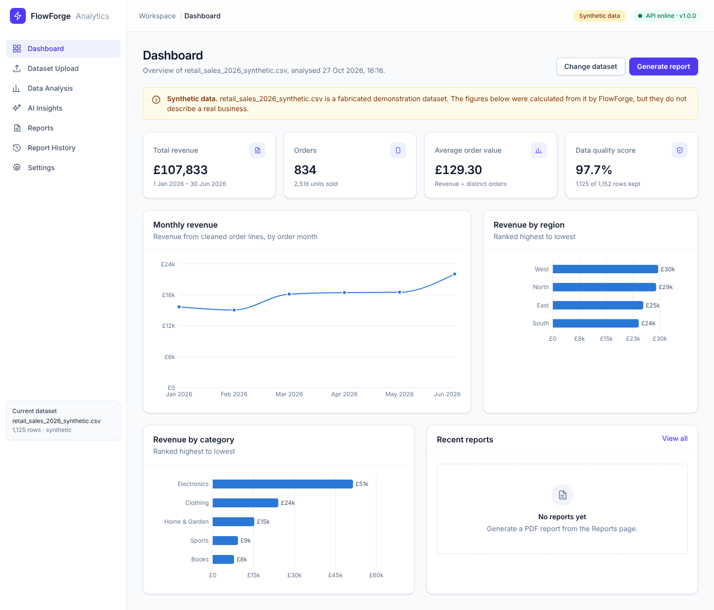

> All bundled data is **synthetic**: fabricated for demonstration, and
> labelled as such everywhere it appears. Figures produced from it are not
> real business findings.

## Features

* **Upload and validation:** CSV only, size and row limits, encoding and
  delimiter detection, strict row-shape checks, required-column checks.
  Every problem is reported in plain language.
* **Data-quality inspection:** per-column types, missing and invalid values,
  duplicate rows, completeness.
* **Documented cleaning:** eight ordered rules (trim, de-duplicate, drop rows
  with missing or invalid required values, harmonise spellings, fill gaps),
  each with a count of the rows or cells it changed.
* **KPIs:** total revenue, orders, units, average order value, revenue by
  month, category, region, channel, customer type and top products. Each KPI
  checks its columns first and is marked *not available* if they are missing.
* **Dashboard:** KPI cards, line and bar charts with tooltips, tables, empty,
  loading and error states, toast notifications, desktop and mobile layouts.
* **Insights:** rule-based observations always; AI-generated insights from
  the Anthropic Claude API when a key is configured. The two are always
  labelled, and only aggregated figures are sent to the AI service.
* **PDF reports:** dataset overview, data-quality summary, KPIs with charts,
  observations and recommendations, limitations, generation date and a
  synthetic-data notice. Stored with a report history (download, delete).
* **Make.com webhook:** sends a `report.generated` JSON event to a Make
  scenario (Slack, Google Sheets, email, …), with retries and a test button.
* **Sample datasets:** two seeded synthetic CSVs, one with deliberate errors.

## Screenshots

All screenshots are of the running application, captured by
`scripts/e2e-smoke.mjs` after analysing `sample-data/retail_sales_2026_synthetic.csv`.

| Dataset upload | Server-side validation error |
| --- | --- |
| 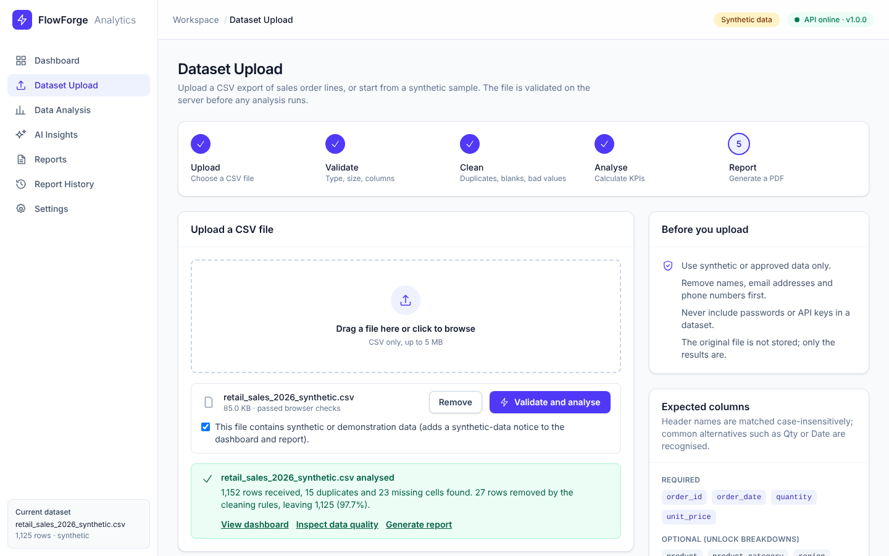 | 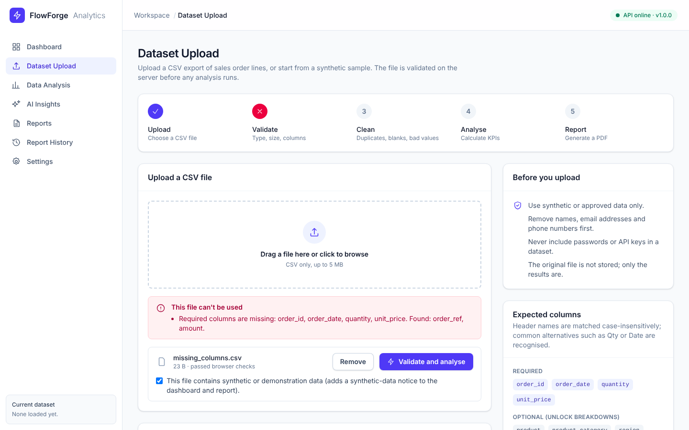 |
| **Data analysis** | **Insights (rule-based fallback, labelled)** |
| 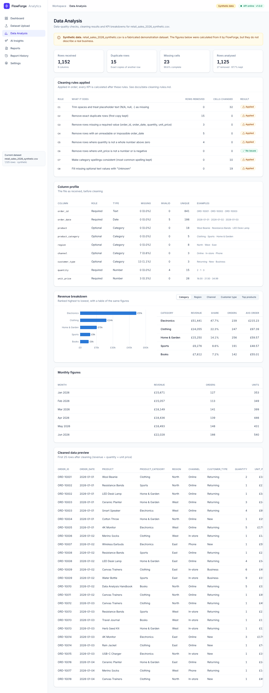 | 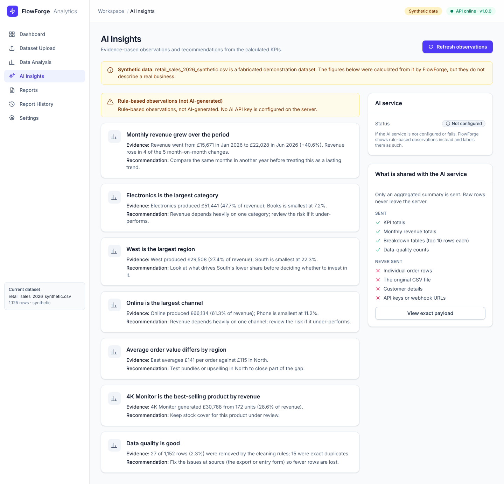 |
| **Reports** | **Report history** |
| 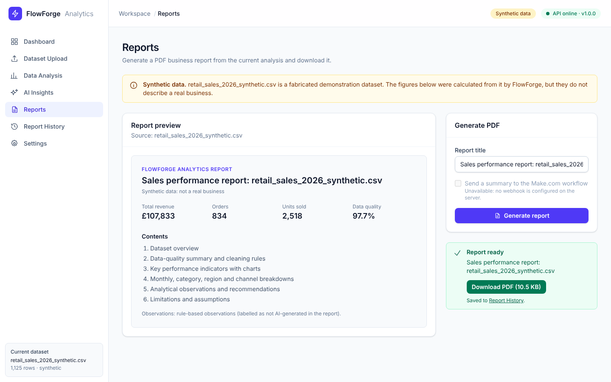 | 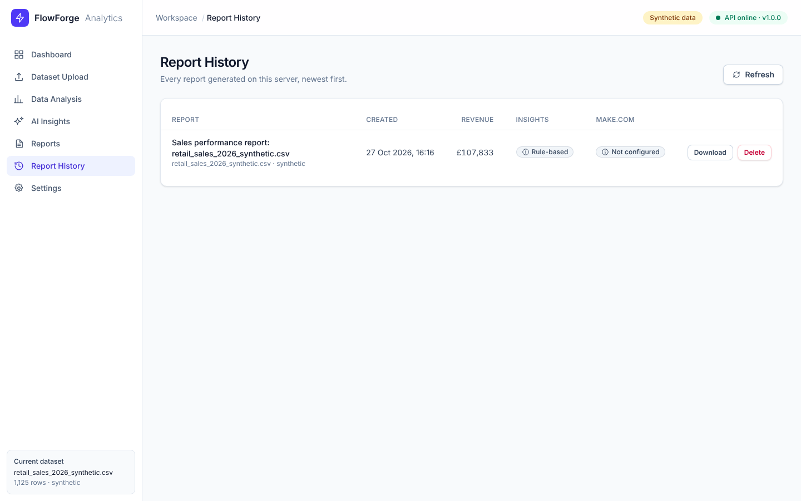 |
| **Settings** | **Generated PDF (page 1)** |
| 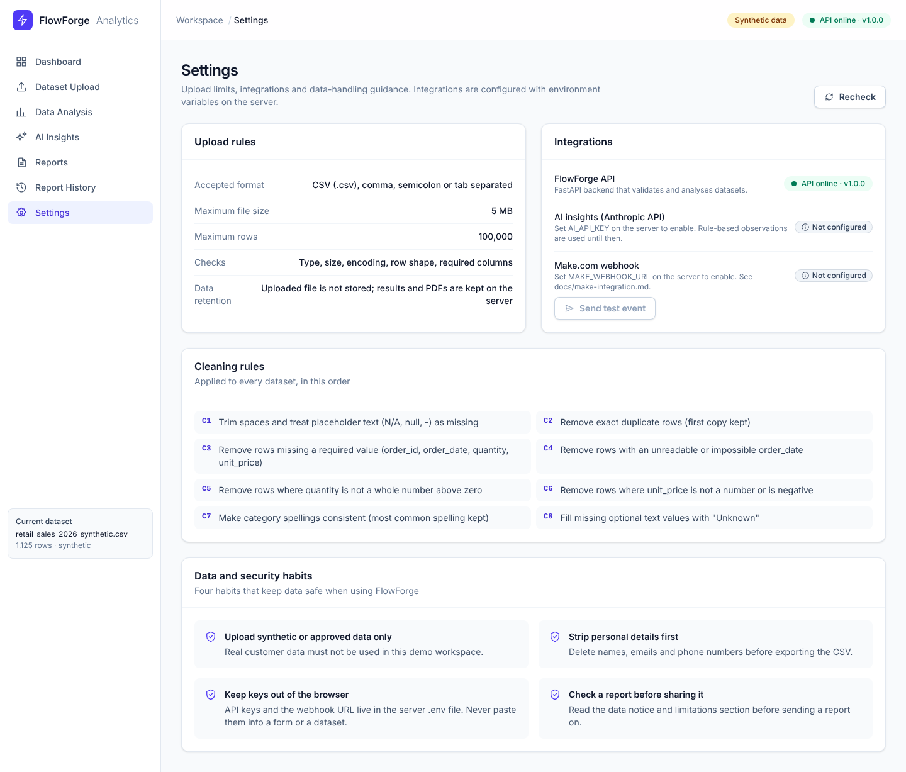 | 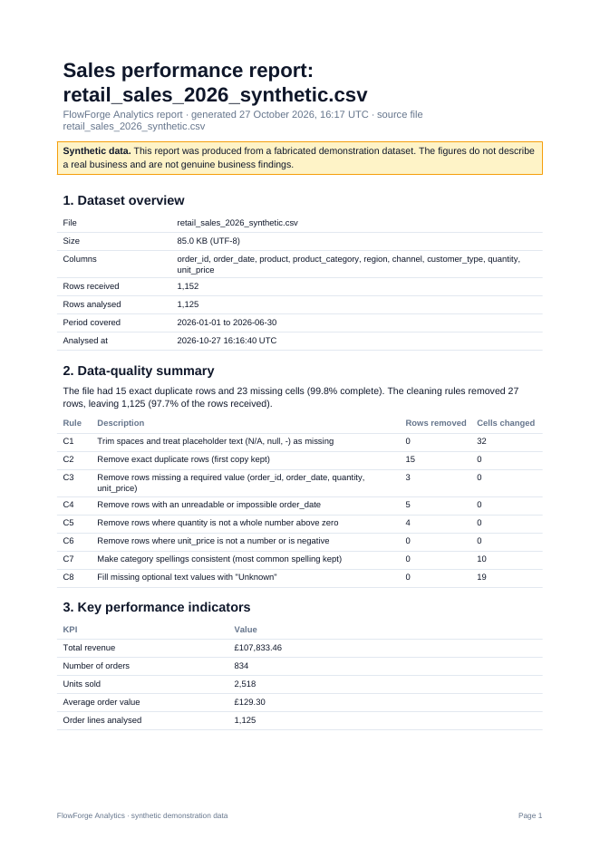 |
| **Mobile** | **Mobile navigation** |
| 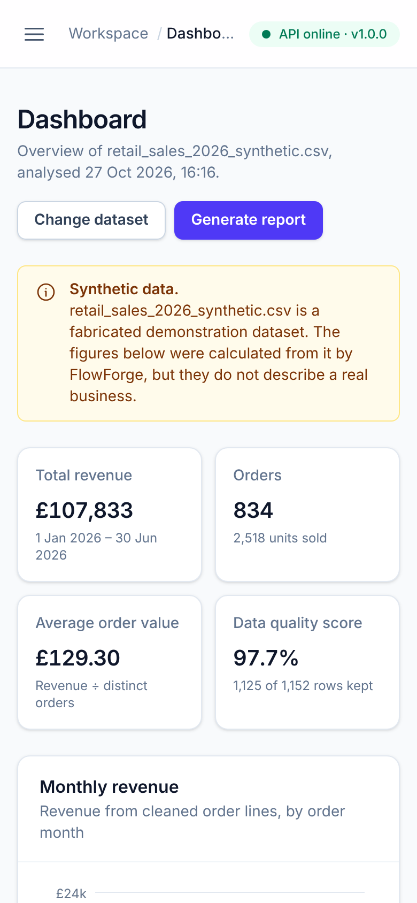 | 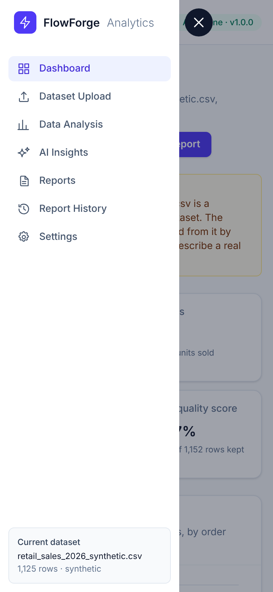 |

## Technology

| Layer | Technology |
| --- | --- |
| Frontend | React 19, TypeScript (strict), Vite 8, Tailwind CSS 4, Recharts 3, React Router 7 |
| Backend | Python 3.13, FastAPI, Pandas, ReportLab (PDF) |
| AI | Anthropic Claude API via the official `anthropic` SDK (structured JSON output) |
| Automation | REST/JSON webhooks to Make.com |
| Tests | pytest, Vitest + Testing Library, Playwright end-to-end script |
| CI | GitHub Actions (tests, lint, type-check, build, end-to-end, Docker) |

## Architecture

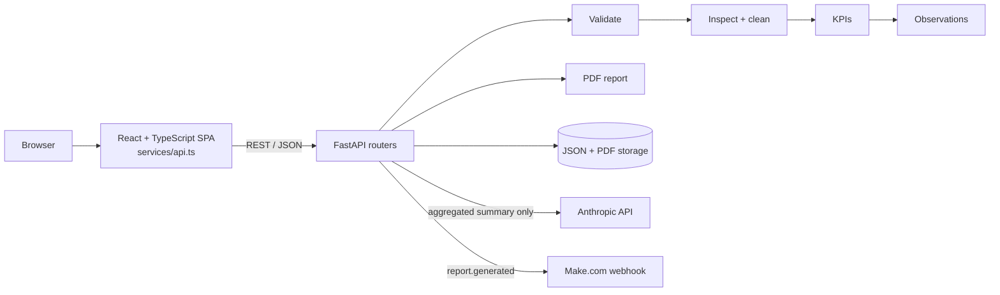

Routes are thin; each pipeline step is a separate module in
`backend/app/services/` with its own tests. In production FastAPI also
serves the built frontend, so the app is one web service. Details and design
decisions: [docs/architecture.md](docs/architecture.md).

## Getting started

Prerequisites: **Python 3.11+** and **Node.js 20+**.

```bash
git clone https://github.com/Bucicovscaia-AI/flowforge-analytics.git
cd flowforge-analytics
cp .env.example backend/.env      # optional: edit to enable AI / Make.com
```

**Backend** (terminal 1):

```bash
cd backend
python -m venv .venv
# Windows: .venv\Scripts\activate    macOS/Linux: source .venv/bin/activate
pip install -r requirements-dev.txt
uvicorn app.main:app --reload --port 8000
```

API docs (Swagger UI): http://localhost:8000/docs

**Frontend** (terminal 2):

```bash
cd frontend
npm ci
npm run dev
```

Open http://localhost:5173, then press **Try the synthetic sample** on the
dashboard or upload a CSV on **Dataset Upload**.

**Single-service mode** (as in production): run `npm run build` in
`frontend/`, then start the backend; http://localhost:8000 serves the app.
Or with Docker: `docker build -t flowforge . && docker run -p 8000:8000 --env-file backend/.env flowforge`.

### CSV format

One row per order line. Header names are case-insensitive and common
alternatives are recognised (`Qty`, `Price`, `Date`, `Category`, …).

| Column | Required | Example |
| --- | --- | --- |
| `order_id` | yes | `ORD-10001` |
| `order_date` | yes | `2026-01-31` or `31/01/2026` |
| `quantity` | yes | `2` |
| `unit_price` | yes | `19.99` or `£19.99` |
| `product`, `product_category`, `region`, `channel`, `customer_type` | optional (unlock breakdowns) | `Wool Beanie`, `Clothing`, `North`, `Online`, `Returning` |

## Configuration

All settings are environment variables (see [`.env.example`](.env.example),
which contains placeholders only). Put real values in `backend/.env`, which
Git ignores.

| Variable | Default | Purpose |
| --- | --- | --- |
| `MAX_UPLOAD_MB` | `5` | Largest upload |
| `MAX_ROWS` / `MAX_COLUMNS` | `100000` / `50` | Dataset limits |
| `FRONTEND_ORIGIN` | `http://localhost:5173` | CORS origin for the dev server |
| `DATA_DIR` | `backend/data` | Where analyses and PDFs are stored |
| `AI_API_KEY` | *(empty)* | Anthropic API key. Empty = labelled rule-based fallback |
| `AI_MODEL` | `claude-opus-5-5` | Model for AI insights |
| `MAKE_WEBHOOK_URL` | *(empty)* | Make.com custom webhook URL (a secret) |
| `MAKE_WEBHOOK_API_KEY` | *(empty)* | Optional key sent as `x-make-apikey` |

## Testing

```bash
cd backend && python -m pytest -v                 # 80 tests
cd frontend && npm run lint && npm run typecheck && npm test && npm run build   # 38 tests
node scripts/e2e-smoke.mjs                        # browser end-to-end, backend on :8000
```

Latest results, coverage of each required scenario and bugs found by
testing: [docs/testing.md](docs/testing.md).

## API

| Endpoint | Purpose |
| --- | --- |
| `GET /api/health`, `GET /api/config` | Status and feature flags (no secrets) |
| `GET /api/samples`, `POST /api/samples/{id}/analyse` | Synthetic samples |
| `POST /api/datasets/upload` | Upload and analyse a CSV |
| `GET /api/analyses`, `GET /api/analyses/{id}` | Stored analyses |
| `GET /api/analyses/{id}/ai-payload`, `POST /api/analyses/{id}/insights` | What the AI would see; generate insights |
| `POST /api/reports`, `GET /api/reports` | Generate a PDF; report history |
| `GET /api/reports/{id}/download`, `DELETE /api/reports/{id}` | Download or delete |
| `POST /api/reports/{id}/notify`, `POST /api/integrations/make/test` | Make.com webhook |

Full reference with request and response shapes: [docs/api.md](docs/api.md).

## Documentation

* [Architecture and design decisions](docs/architecture.md)
* [API reference](docs/api.md)
* [Data validation and cleaning rules](docs/data-cleaning-rules.md)
* [AI insights](docs/ai-insights.md)
* [Make.com integration](docs/make-integration.md): trigger, payload, set-up, responses, errors, security
* [Testing](docs/testing.md)
* [Development log](docs/development-log.md)

## Security

* Files are validated on the server (type, content, size, encoding, shape,
  columns) even though the browser checks them first.
* Every cell is parsed as text; nothing in a file is executed or evaluated.
* The uploaded file is never written to disk; only derived results are kept.
* Secrets live in environment variables only. The API reports *whether* AI
  and Make.com are configured, never the key or URL.
* Only aggregated figures go to the AI service and to Make.com.
* Report and analysis ids are validated before they are used as file names;
  unknown `/api` routes never fall through to the frontend.
* The interface reminds users to upload synthetic or anonymised data only.

## Known limitations

* Single-user design: no login, and analyses and reports are visible to
  anyone who can reach the server. Storage is JSON and PDF files, not a
  database.
* Revenue is quantity × unit price; discounts, refunds, tax, shipping and
  currency conversion are not modelled. Negative quantities (returns) are
  removed.
* AI insights and Make.com delivery were tested against mocked services only;
  no live API key or Make account was used during development.
* The Docker image is built and checked by CI, but could not be built in the
  development environment (Docker Hub rate limit).
* The application is not deployed; it runs locally or in Docker.

## Future improvements

* User accounts and per-user storage (e.g. PostgreSQL), with automatic
  clean-up of old analyses.
* Column mapping in the interface for files with unusual headers.
* Scheduled reports and more webhook events (e.g. data-quality alerts).
* Comparison between two periods or two uploads.
* Hosted demo deployment (the Dockerfile is ready for a single web service
  such as Render).

## Credits

Architecture and presentation were inspired by the public
[InsightBoard](https://github.com/bhargavachanduthalupuri/insightboard)
project (MIT). No code was copied from it; FlowForge's source, design and
sample data are original.
