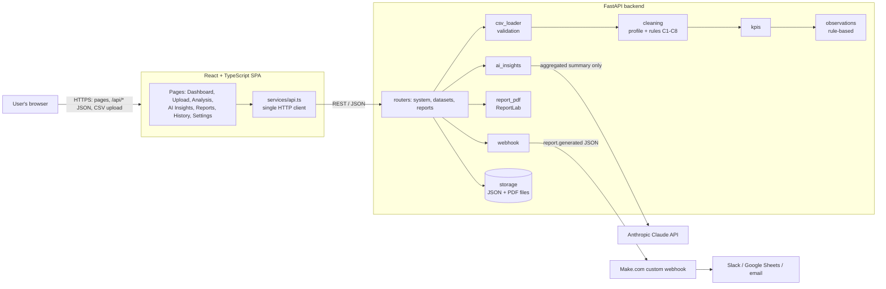

# Architecture

FlowForge is a single repository with a React single-page app and a Python
API. In development they run as two processes (Vite proxies `/api` to
FastAPI). In production FastAPI also serves the built frontend, so the whole
application is one web service.



## Request flow: upload to report

1. **Upload** (`POST /api/datasets/upload`): the browser checks extension
   and size for instant feedback; the server repeats every check
   (`csv_loader.load_csv`). The raw file is held in memory only.
2. **Inspect** (`cleaning.profile_dataset`): column types, missing and
   invalid values, duplicates.
3. **Clean** (`cleaning.clean_dataset`): rules C1–C8, with counts per rule.
4. **Calculate** (`kpis.calculate_kpis`): each KPI checks its required
   columns first; missing ones are reported as unavailable.
5. **Observe** (`observations.build_observations`): rule-based findings.
6. **Store** (`storage.Store`): the analysis (profile, KPIs, observations,
   a 25-row preview) is saved as JSON. The browser keeps only the analysis id.
7. **Insights** (`POST /api/analyses/{id}/insights`): AI or labelled fallback.
8. **Report** (`POST /api/reports`): a PDF is built from the stored analysis
   and saved; history lists it; Make.com is notified if requested.

## Design decisions

| Decision | Reason |
| --- | --- |
| Thin routes, logic in `app/services` | Each step can be unit-tested without HTTP; routes only translate errors into status codes |
| Every cell read as text, typed by the cleaning rules | Type conversion is explicit and documented, not guessed by pandas |
| Python `csv` module (strict) instead of `pandas.read_csv` for parsing | pandas silently shifts cells on rows with extra fields; strict parsing reports them |
| Store derived results, not uploads | Less personal data at rest; reports are reproducible from the stored analysis |
| JSON files instead of a database | No infrastructure for a single-user demo; `Store` is the only class to replace for a database |
| `create_app(settings)` factory | Tests get an isolated app with a temporary data folder and integrations off |
| ReportLab for PDF | Pure Python, no headless browser or system libraries needed |
| AI behind a labelled fallback | The app is fully usable without an API key, and users can always tell AI text from rule-based text |
| Webhook URL server-side only | The URL is a credential; the browser only sees "configured" and the host name |
| One service in production | One URL, no CORS configuration, one deployment (see `Dockerfile`) |
| TypeScript strict mode, one API client (`services/api.ts`) | Response shapes (`src/types.ts`) are checked at compile time; error handling is in one place |

## Repository layout

```
flowforge-analytics/
├── backend/
│   ├── app/
│   │   ├── main.py            App factory, middleware, static frontend
│   │   ├── config.py          Settings from environment variables
│   │   ├── deps.py            Shared request helpers
│   │   ├── samples.py         Registry of the synthetic sample datasets
│   │   ├── storage.py         JSON/PDF file storage
│   │   ├── routers/           system.py, datasets.py, reports.py
│   │   └── services/          csv_loader, cleaning, kpis, observations,
│   │                          ai_insights, report_pdf, webhook, pipeline
│   ├── tests/                 pytest unit and API tests
│   └── requirements*.txt
├── frontend/
│   └── src/
│       ├── pages/             One component per page
│       ├── components/        layout/, ui/, charts/
│       ├── context/           Current analysis and toast notifications
│       ├── services/api.ts    The only place that calls the backend
│       ├── types.ts           API response types
│       └── test/              Vitest setup, API mock, backend-generated fixtures
├── sample-data/               Synthetic CSVs and their seeded generator
├── scripts/e2e-smoke.mjs      Browser end-to-end test and screenshot capture
├── screenshots/               Screenshots of the running application
├── docs/                      Architecture, API, cleaning rules, AI, Make.com, testing
├── .github/workflows/ci.yml   Tests, build, end-to-end and Docker checks
├── Dockerfile                 Single-service production image
└── .env.example               Configuration placeholders
```
