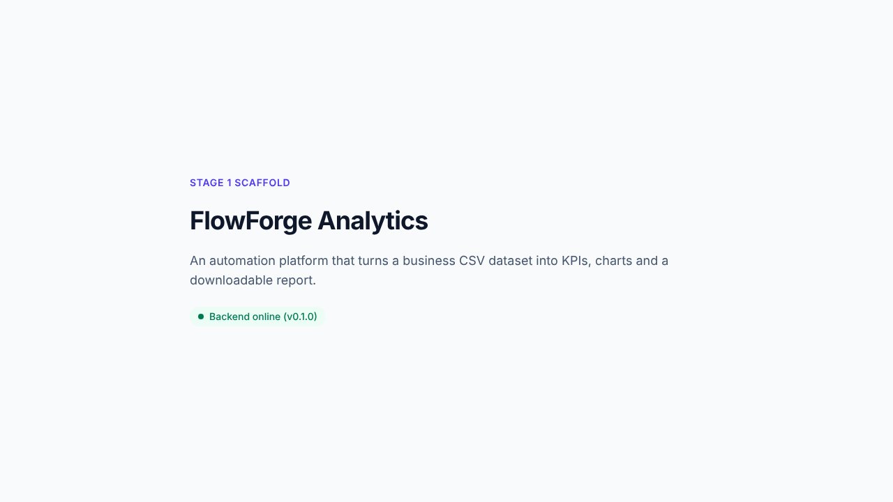

# Stage 1 Report: Environment Inspection and Project Structure

**Project:** FlowForge Analytics: An AI-Powered Automation Platform for Business Reporting
**Module:** PFD200 Professional Development
**Stage date:** 27 October 2026
**Repository:** https://github.com/Bucicovscaia-AI/flowforge-analytics
**Portfolio sections supported:** 1.3 Project Management, 1.4 Project Execution, 3.4 Digital Portfolio

---

## 1. Stage objective

Confirm that the development environment can build and run the chosen
technology stack, then create a maintainable project structure with a working
connection between the frontend and the backend.

## 2. Summary of work completed

| Task | Outcome |
| --- | --- |
| Inspect the development environment | Completed. All required tools were available (Table 1). |
| Review assessment requirements | Completed. Requirements from the PFD200 brief and portfolio template were mapped to project stages. |
| Produce an implementation plan | Completed. A ten-stage plan was compressed to fit the 30 October deadline (see `docs/project-plan.md`). |
| Create the project structure | Completed. Frontend, backend, documentation and sample-data folders created. |
| Verify that the scaffold runs | Completed. Backend tests passed, frontend built, and the frontend reached the backend in a browser. |
| Publish to GitHub | Completed. Code pushed to the `main` branch. |

**Table 1: Development environment**

| Tool | Version | Purpose |
| --- | --- | --- |
| Node.js / npm | 22.22.0 / 10.9.4 | Running and building the React frontend |
| Python | 3.13 | FastAPI backend and Pandas data processing |
| Git | 2.43.0 | Version control |
| GitHub | n/a | Remote repository and digital portfolio |
| Jira | n/a | Backlog and sprint board |

## 3. Scope decisions

* **Minimum viable product:** upload CSV → validate → clean → calculate KPIs →
  display dashboard → download report.
* **Stage 7 (AI insights) and Stage 8 (Make.com webhook):** agreed on
  27 October to deliver these as documented prototypes. They will be clearly
  labelled as not live integrations.
* **Data:** a fabricated (synthetic) retail sales dataset will be used
  throughout. No real personal or business data is processed.

## 4. Architecture and technical decisions

**Figure 1: Stage 1 architecture**

```
 Browser
   │  http://localhost:5173
   ▼
 React + Vite frontend ──── /api/* (Vite dev proxy) ────▶ FastAPI backend :8000
   └─ services/api.js                                       └─ GET /api/health
```

**Table 2: Technical decisions**

| Decision | Reason |
| --- | --- |
| One repository with `frontend/` and `backend/` folders | Keeps the whole project in one portfolio link while keeping a clear boundary between the user interface and data processing. |
| React with Vite | Fast development server and a simple build. React components can be reused across the seven planned pages. |
| Tailwind CSS v4 | Utility classes give consistent spacing and typography without a large custom stylesheet. |
| FastAPI | Python framework with automatic input validation and interactive API documentation at `/docs`. It also allows Pandas to be used directly. |
| Vite development proxy for `/api` | The browser sees one origin, which avoids cross-origin (CORS) errors during development. |
| Service layer (`frontend/src/services/api.js`) | All network calls and error handling sit in one file, so components stay simple and error messages are consistent. |
| Settings in environment variables (`.env`, excluded from Git) | Keeps future secrets, such as API keys and webhook URLs, out of the source code. `.env.example` documents the variables without real values. |
| Pinned dependency versions | The project installs the same way on any machine, including the marker's. |

## 5. Files created

| Path | Purpose |
| --- | --- |
| `backend/app/main.py` | FastAPI application, CORS configuration and `/api/health` endpoint |
| `backend/app/config.py` | Reads settings from environment variables |
| `backend/tests/test_health.py` | Automated tests for the health endpoint |
| `backend/requirements.txt`, `requirements-dev.txt` | Pinned Python dependencies |
| `frontend/src/App.jsx` | Placeholder page (replaced in Stage 2) |
| `frontend/src/services/api.js` | Service layer for backend requests |
| `frontend/src/components/BackendStatus.jsx` | Status indicator showing loading, success and error states |
| `frontend/vite.config.js` | Tailwind plugin and `/api` proxy |
| `.env.example`, `.gitignore` | Example settings and Git exclusions |
| `README.md` | Project overview and run instructions |
| `docs/project-plan.md` | Implementation plan and scope |
| `docs/development-log.md` | Development log |
| `sample-data/README.md` | Statement that all data is synthetic |

## 6. How to run

**Backend**
```bash
cd backend
python -m venv .venv
.venv\Scripts\activate          # Windows  (macOS/Linux: source .venv/bin/activate)
pip install -r requirements-dev.txt
uvicorn app.main:app --reload --port 8000
```

**Frontend** (second terminal)
```bash
cd frontend
npm install
npm run dev
```

Open http://localhost:5173.

## 7. Testing

**Table 3: Stage 1 test results**

| ID | Test | Method | Expected result | Actual result | Status |
| --- | --- | --- | --- | --- | --- |
| T1.1 | Health endpoint returns OK | pytest `test_health_returns_ok` | HTTP 200, `status: ok` | HTTP 200, `status: ok` | Pass |
| T1.2 | Unknown route is rejected | pytest `test_unknown_route_returns_404` | HTTP 404 | HTTP 404 | Pass |
| T1.3 | Frontend production build | `npm run build` | Build completes without errors | Build completed | Pass |
| T1.4 | Frontend code quality | `npx oxlint` | No lint problems | No problems reported | Pass |
| T1.5 | Frontend connects to backend | Manual browser check with both servers running | Status shows "Backend online" | "Backend online (v0.1.0)" displayed (Figure 2) | Pass |

Command used for T1.1 and T1.2:
```bash
cd backend
python -m pytest -v
```

Recorded output:
```
tests/test_health.py::test_health_returns_ok PASSED          [ 50%]
tests/test_health.py::test_unknown_route_returns_404 PASSED  [100%]
============================== 2 passed ==============================
```

**Figure 2: Frontend confirming a live connection to the backend**



## 8. Problems encountered and resolutions

| Problem | Investigation | Resolution |
| --- | --- | --- |
| Installing frontend test tools (Vitest, Testing Library) failed with the npm error `Cannot read properties of null (reading 'edgesOut')`. | The error came from npm's dependency resolver, not from project code. Frontend tests were not needed until components exist. | Deferred to Stage 2, to be retried with explicit versions. Recorded as an open item. |
| The first pytest run showed a deprecation warning: FastAPI's test client now expects `httpx2` instead of `httpx`. | Read the warning text, which named the replacement package. | Replaced `httpx` with `httpx2` in `requirements-dev.txt`. The rerun showed no warnings. |

## 9. Evidence checklist

| # | Evidence | Status | Portfolio section |
| --- | --- | --- | --- |
| E1 | Screenshot: frontend showing "Backend online" (Figure 2) | Captured | 1.4 |
| E2 | Screenshot: your own terminal running `python -m pytest -v` | **To capture** | 1.4 |
| E3 | Screenshot: GitHub repository page and commit history | **To capture** | 1.3, 3.4 |
| E4 | Screenshot: Jira backlog and board | Captured | 1.3 |
| E5 | Screenshot: FastAPI interactive docs at http://localhost:8000/docs | **To capture** | 1.4 |

## 10. Limitations and open items

* No frontend automated tests yet (planned for Stage 2).
* The page is a placeholder. The dashboard layout arrives in Stage 2.
* No data processing yet. Upload and validation arrive in Stage 3.

## 11. Next stage

**Stage 2: Dashboard user interface.** Build the sidebar, the top bar and the
seven pages (Dashboard, Dataset Upload, Data Analysis, AI Insights, Reports,
Report History, Settings), with KPI cards, charts, tables and empty, loading
and error states. All figures will use clearly labelled synthetic sample data.

---

## Development log entry (27 October 2026)

**Date:** 27/10/2026
**Stage:** 1, environment and project structure
**Work completed:** Inspected the development environment. Reviewed the
assessment requirements. Produced and agreed a compressed implementation plan.
Created the repository structure, a FastAPI health endpoint, a React frontend
with a service layer and status indicator, and backend tests. Pushed to GitHub.
**Technical decisions:** Single repository, Vite proxy, service layer,
environment-variable configuration, pinned dependencies (Table 2).
**Problems and resolution:** npm resolver error (deferred); `httpx`
deprecation (replaced with `httpx2`) (Section 8).
**Skills developed:** [Add in your own words, e.g. which of these were new
to you: project scaffolding, dependency management, proxies and CORS,
environment variables, automated testing with pytest.]
**Evidence produced:** E1 and E4 captured. E2, E3 and E5 to capture.
**Remaining limitations:** Section 10.

> **Academic integrity note:** This report was prepared with an AI coding
> assistant (Claude). Use it as a factual record and evidence appendix, and
> declare AI use on the cover sheet. Write your reflective sections (self-
> assessment, skills developed, Task 2 reflection) in your own words.
