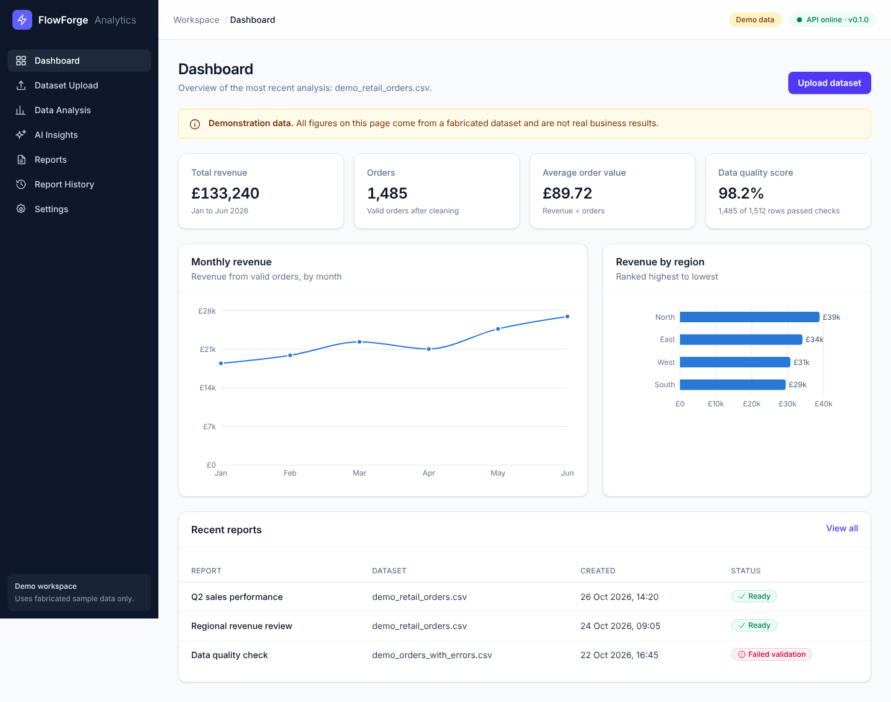
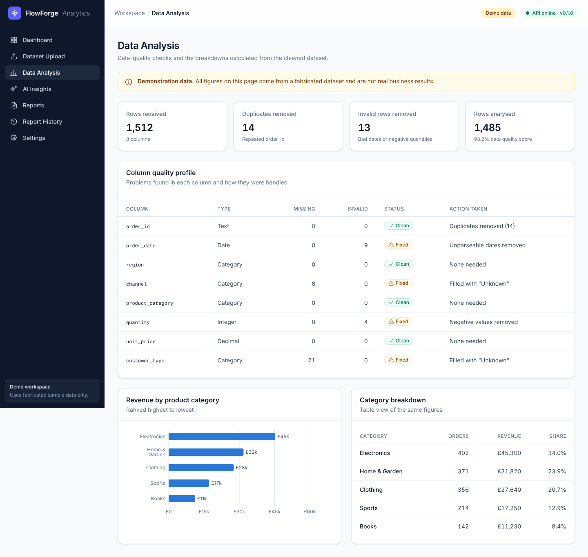
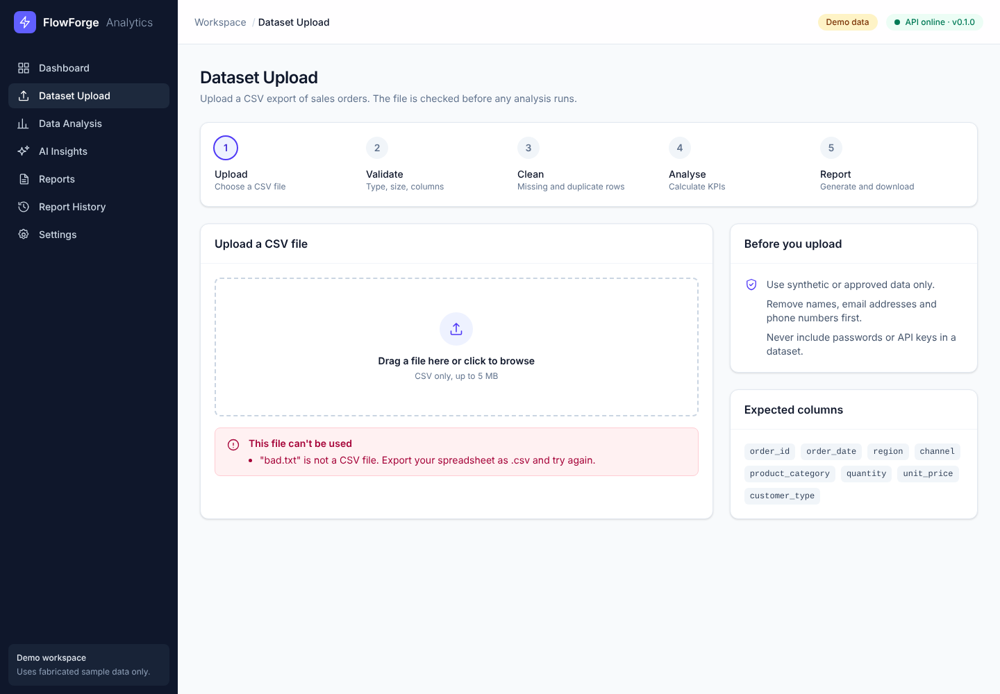
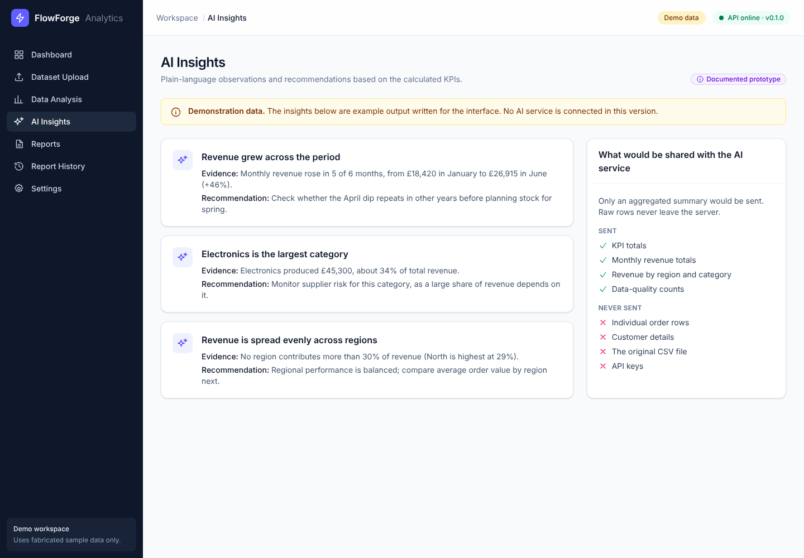
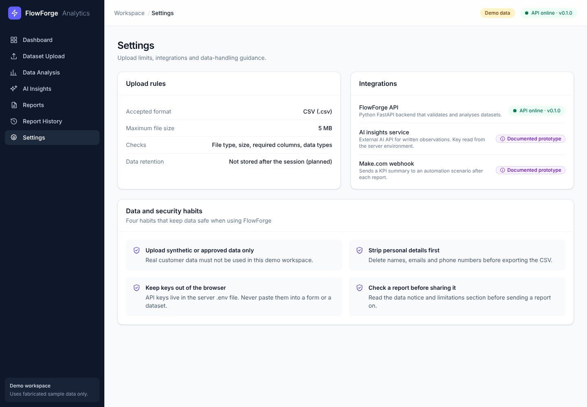
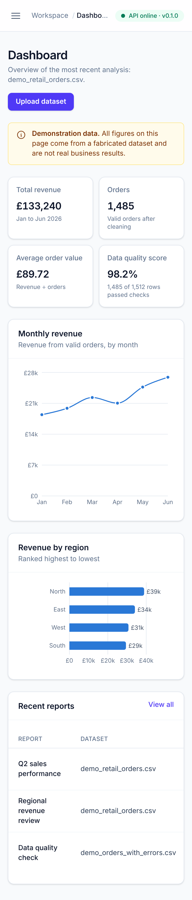
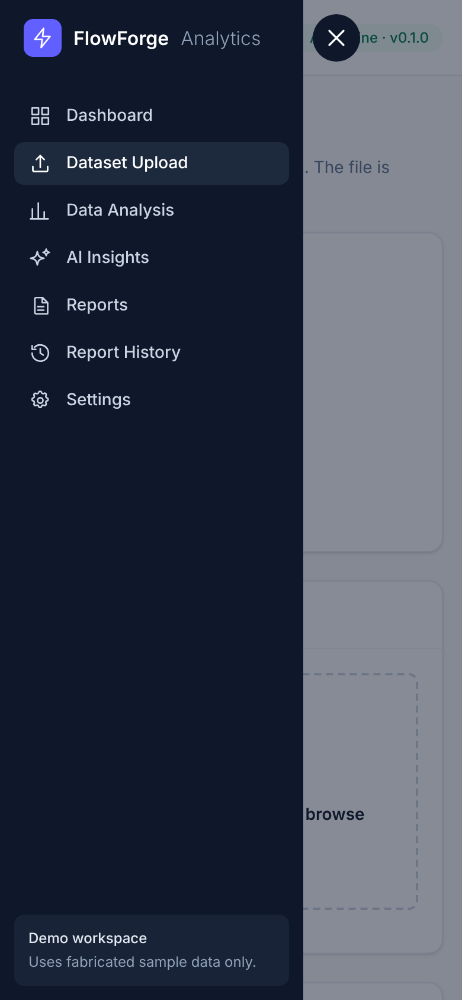

# Stage 2 Report: Dashboard User Interface

**Project:** FlowForge Analytics: An AI-Powered Automation Platform for Business Reporting
**Module:** PFD200 Professional Development
**Stage date:** 27 October 2026
**Repository:** https://github.com/Bucicovscaia-AI/flowforge-analytics
**Portfolio sections supported:** 1.4 Project Execution (interface, testing, security awareness campaign), 3.4 Digital Portfolio

---

## 1. Stage objective

Build a professional, responsive analytics dashboard with all seven required
pages. Use clearly labelled demonstration data so the interface can be
designed and tested before the backend analysis exists.

## 2. Summary of work completed

| Requirement (from project brief) | Delivered |
| --- | --- |
| Sidebar navigation menu | Fixed dark sidebar on desktop, slide-in menu on mobile |
| Top navigation area | Page title, "Demo data" badge, live API status |
| KPI cards | Total revenue, orders, average order value, data quality score |
| Responsive charts | Monthly revenue line chart, ranked bar charts by region and category |
| Clear data tables | Recent reports, column quality profile, category breakdown, report history |
| Progress and status indicators | Five-step processing pipeline; status badges with icon and text |
| Informative empty states | "No reports generated yet", "Page not found" |
| Loading indicators and error messages | API status "Checking…" state; CSV validation errors |
| Accessible forms and buttons | Labelled file input, keyboard focus styles, ARIA roles for alerts and status |
| Desktop and mobile layouts | Tested at 1440 px and 390 px width |
| Seven pages | Dashboard, Dataset Upload, Data Analysis, AI Insights, Reports, Report History, Settings |
| Demonstration data clearly labelled | Notice on every page that shows sample figures, plus a badge in the top bar |

## 3. How the interface is organised

**Figure 1: Frontend component structure**

```
App (React Router)
└── AppLayout ─── Sidebar · TopBar (BackendStatus)
    └── Page (one of seven)
        ├── PageHeader · DemoNotice
        ├── KpiCard · Card · DataTable · StatusBadge · Alert · EmptyState
        └── RevenueTrendChart · HorizontalBarChart
                 ▲
        data/sampleData.js   (replaced by services/api.js results in Stage 5)
```

* **Layout component.** `AppLayout` draws the sidebar and top bar once. Each
  page is rendered inside it, so navigation is consistent and is written in
  only one place.
* **Reusable components.** Pages are built from about a dozen small
  components. For example, `DataTable` receives a list of column definitions
  and rows, so the same component draws four different tables.
* **One source of sample data.** Every sample figure lives in
  `src/data/sampleData.js`, and the KPIs are calculated from those rows
  instead of being typed in by hand. In Stage 5 this file is replaced by real
  API results without redesigning the pages.

## 4. Key design and technical decisions

| Decision | Reason |
| --- | --- |
| React Router with a shared layout route | Gives each page its own URL (bookmarkable, back button works) without reloading the app. |
| Ranked horizontal bar charts instead of pie charts | Bar lengths are easier to compare accurately than slice angles, and long category names fit on the left. |
| Colour-blind-checked chart colour and status colours with icons and text | Information is never conveyed by colour alone (WCAG accessibility guidance). |
| A separate table view beside the category chart | Gives screen-reader users and anyone who needs exact numbers the same information. |
| Browser-side file validation (`utils/validateFile.js`) | Instant feedback for the user. The backend will repeat every check in Stage 3, because browser checks can be bypassed. |
| Inline SVG icons instead of an icon library | Avoids an extra dependency for about 18 icons. |
| GBP currency and UK date formats (`Intl` API) | Matches the intended UK business audience. |

## 5. Security awareness campaign elements built into the interface

These support the campaign required in portfolio section 1.4. They are aimed
at the people who upload data to FlowForge.

| Location | Message | Behaviour targeted |
| --- | --- | --- |
| Dataset Upload, "Before you upload" panel | Use synthetic or approved data; remove names, emails and phone numbers; never include passwords or API keys | Users remove personal data before uploading |
| Settings, "Data and security habits" | Four habits: approved data only, strip personal details, keep keys out of the browser, check reports before sharing | Users keep API keys on the server; users review reports before sharing them |
| AI Insights, "What would be shared" panel | Lists exactly what an AI service would and would not receive | Users trust that raw rows are not sent outside the system |

## 6. Access for the lecturer

The lecturer needs to test the app from his own device. Recommended approach:

* **Hosted link (recommended).** Deploy the app as a single free Render web
  service. FastAPI serves both the API and the built React pages, giving one
  URL with no extra setup. Planned for Stage 5, so there is time to fix any
  hosting problems before the deadline. The free tier sleeps when idle, so the
  first visit may take about a minute.
* **Local run (fallback).** Step-by-step commands in `README.md`.

## 7. Files created or modified

| Path | Purpose |
| --- | --- |
| `frontend/src/App.jsx` | Routes for the seven pages |
| `frontend/src/components/layout/` | `AppLayout`, `Sidebar`, `TopBar`, navigation list |
| `frontend/src/components/ui/` | Reusable components (KPI card, table, badges, alerts, etc.) |
| `frontend/src/components/charts/` | Line chart, bar chart and shared chart styling |
| `frontend/src/pages/` | Seven pages plus not-found page |
| `frontend/src/data/sampleData.js` | Fabricated demonstration data |
| `frontend/src/utils/` | Formatting helpers and CSV file validation |
| `frontend/src/**/*.test.js(x)`, `src/test/setup.js` | Frontend automated tests |
| `frontend/vite.config.js`, `package.json` | Test configuration and `npm test` script |
| `README.md`, `docs/project-plan.md`, `docs/development-log.md` | Updated documentation |
| `docs/evidence/stage2/` | Eleven screenshots |

## 8. How to run

```bash
# Terminal 1: backend
cd backend
.venv\Scripts\activate          # Windows  (macOS/Linux: source .venv/bin/activate)
uvicorn app.main:app --reload --port 8000

# Terminal 2: frontend
cd frontend
npm install
npm run dev
```

Open http://localhost:5173. The interface also works without the backend;
the top bar then shows "API offline".

## 9. Testing

**Table 1: Stage 2 test results**

| ID | Test | Method | Expected | Actual | Status |
| --- | --- | --- | --- | --- | --- |
| T2.1 | Valid CSV accepted (including upper-case `.CSV`) | Vitest unit tests | No errors | No errors | Pass |
| T2.2 | Missing, non-CSV, empty and over-5 MB files rejected with clear messages | Vitest unit tests (5 cases) | Specific error message for each | Correct message for each | Pass |
| T2.3 | Sample data is internally consistent (region and category totals equal total revenue) | Vitest unit tests (3 cases) | Totals match | Totals match | Pass |
| T2.4 | Each of the seven pages renders with the correct heading | Vitest + Testing Library (7 cases) | Heading visible | Heading visible | Pass |
| T2.5 | Unknown URL shows "Page not found" | Vitest + Testing Library | Message visible | Message visible | Pass |
| T2.6 | Dashboard shows the demonstration-data notice | Vitest + Testing Library | Notice visible | Notice visible | Pass |
| T2.7 | Upload page shows an error for a PDF file and accepts a CSV file | Vitest + Testing Library (2 cases) | Error shown / file name shown | As expected | Pass |
| T2.8 | Backend tests still pass | pytest | 2 passed | 2 passed | Pass |
| T2.9 | Production build | `npm run build` | Build succeeds | Succeeded (bundle-size warning, see section 11) | Pass |
| T2.10 | Code quality | `npx oxlint` | No problems | No problems | Pass |
| T2.11 | No browser console errors on any page | Playwright, all 7 pages | 0 errors | 0 errors | Pass |
| T2.12 | No horizontal scrolling on a phone-width screen | Playwright at 390 px | Page width 390 px | 390 px | Pass |

Commands:
```bash
cd frontend && npm test
cd backend && python -m pytest -v
```

Recorded frontend output:
```
 Test Files  3 passed (3)
      Tests  21 passed (21)
```

## 10. Screenshots

**Figure 2: Dashboard (desktop)**


**Figure 3: Data Analysis, showing the column quality profile**


**Figure 4: Dataset Upload, rejecting a non-CSV file**


**Figure 5: AI Insights, labelled as a documented prototype**


**Figure 6: Settings, with integration status and security habits**


**Figure 7: Mobile layout and navigation menu**



Further screenshots: `docs/evidence/stage2/` (Reports, Report History, Upload, mobile Upload).

## 11. Problems encountered and resolutions

| Problem | Investigation | Resolution |
| --- | --- | --- |
| `npm install -D vitest` crashed with `Cannot read properties of null (reading 'edgesOut')` | The npm debug log showed the crash inside npm's dependency resolver (`@npmcli/arborist`) while it handled Vitest's optional peer dependencies. This pointed to an npm 10 bug, not a project error. | Installed with a newer npm (`npx npm@11 install -D vitest`). Confirmed that a clean `npm ci` with npm 10 works from the lock file, so other users are not affected. |
| Tests printed "width(0) and height(0) of chart" warnings | jsdom (the test browser) does not calculate layout, so charts measured 0×0 | A test setup file gives charts a fixed size. The warnings stopped. |
| The first dashboard screenshot showed a half-drawn line chart | The chart animates on load and the screenshot was taken too early | Screenshots were retaken after the animation finished. |
| Sample insight said revenue "rose in 5 of 6 months" | Checked against the data: 6 months give only 5 month-on-month changes, and 4 of them were rises | Corrected the text, so the example insight is accurate for its own data. |

## 12. Limitations and open items

* All figures are fabricated demonstration data. Real results arrive in Stage 5.
* The Upload page validates files in the browser only. The backend endpoint is Stage 3.
* Report download and saved report history are not functional yet (Stage 6).
* The JavaScript bundle is 666 kB (199 kB compressed), mainly from the chart library.
  Acceptable for this project; code-splitting could reduce it.
* There is no dark mode. The brief asked for a light interface.

## 13. Evidence checklist

| # | Evidence | Status | Portfolio section |
| --- | --- | --- | --- |
| E6 | Screenshots of all seven pages (desktop) | Captured (`docs/evidence/stage2/`) | 1.4 |
| E7 | Mobile screenshots (dashboard, upload, menu) | Captured | 1.4 |
| E8 | Upload validation error screenshot | Captured | 1.4 |
| E9 | Screenshot of your own terminal running `npm test` | **To capture** | 1.4 |
| E10 | Jira board with Stage 2 items moved to Done | **To capture** | 1.3 |
| E11 | GitHub commit for Stage 2 | **To capture** | 1.3, 3.4 |

## 14. Next stage

**Stage 3: Python backend and CSV validation.** A `POST /api/upload`
endpoint will check file type, size, encoding, required columns and data
types. It will return clear HTTP 400, 413 and 422 errors, backed by pytest
tests. It also includes a seeded script that generates the fabricated
dataset, with deliberate errors for the quality checks to find.

---

## Development log entry (27 October 2026)

**Date:** 27/10/2026
**Stage:** 2, dashboard interface
**Work completed:** Built the layout, the reusable components and all seven
pages, with labelled demonstration data, browser-side CSV validation, the
security awareness campaign elements and 21 automated frontend tests.
Planned hosting for lecturer access.
**Technical decisions:** Section 4.
**Problems and resolution:** Section 11.
**Skills developed:** [Add in your own words, e.g. component-based UI design,
responsive layout, accessibility, data visualisation, frontend testing,
debugging a package-manager error from its logs.]
**Evidence produced:** E6 to E8 captured; E9 to E11 to capture.
**Remaining limitations:** Section 12.

> **Academic integrity note:** This report was prepared with an AI coding
> assistant (Claude). Use it as a factual record and evidence appendix, and
> declare AI use on the cover sheet. Write your reflective sections in your
> own words.
